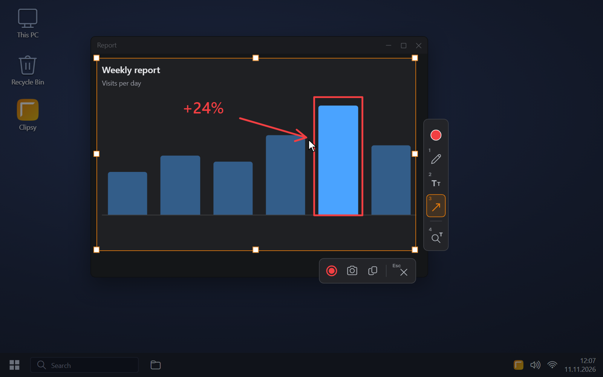
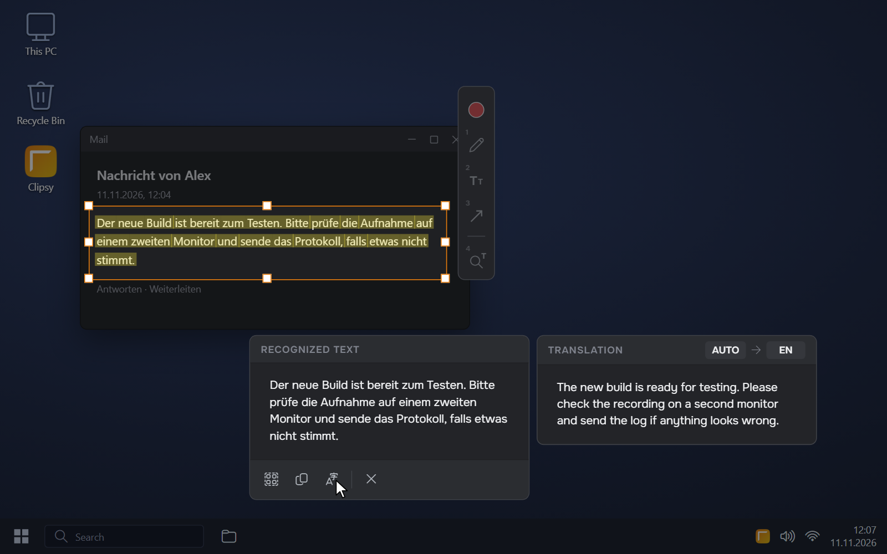
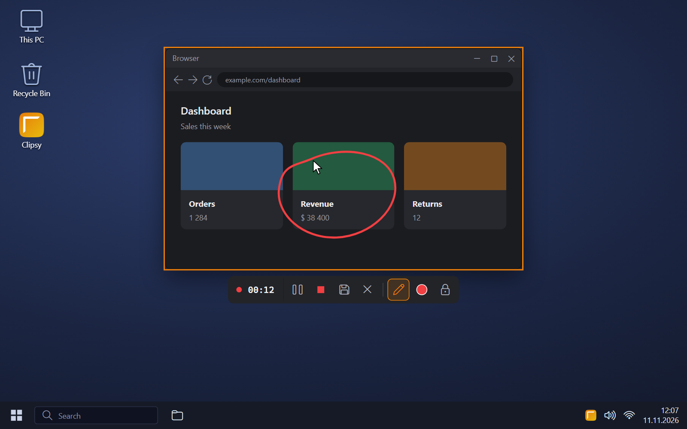
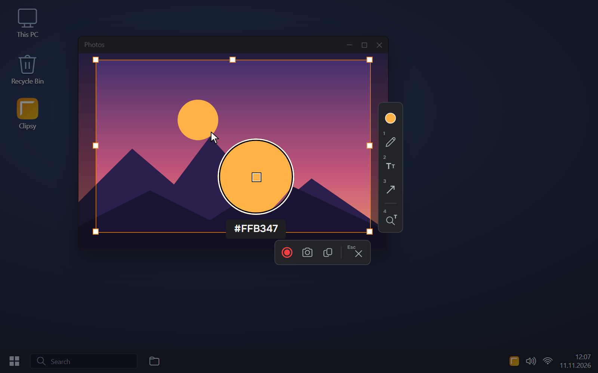
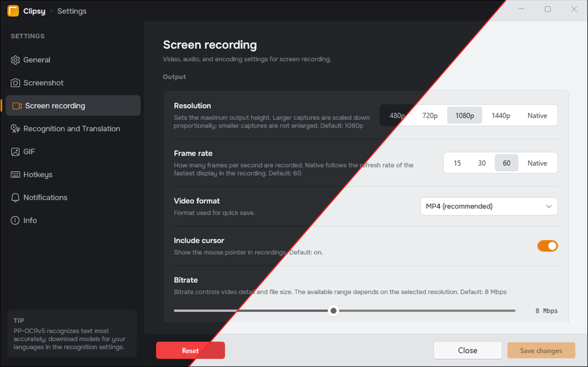

# Clipsy

Screenshot and screen recording tool for Windows 10 and 11

[Website](https://sidiusz.github.io/Clipsy/) · [Download](https://github.com/Sidiusz/Clipsy/releases/latest) · [На русском](https://sidiusz.github.io/Clipsy/ru/)



Clipsy is a small, fast alternative to the Windows Snipping Tool. It lets you take a screenshot and draw on it right away, recognize and translate text from the screen, and record video or GIF. And all of it in one app!

## Features

- **Screenshots**: easy capture of one or several monitors, as well as individual apps
- **Drawing**: a simple editor right on top of the screenshot: pencil, shapes, lines, arrows and text
- **Screen recording**: a region or a window to popular video formats, with drawing, microphone and the sound of individual apps
- **GIF export**: a recording saved as an animated GIF with adjustable frame rate and colours
- **Text recognition**: text copied straight from the screen, with translation
- **Colour picker**: precise colour picking from any point on the screen with a magnifier
- **Hotkeys**: your own shortcuts in place of the default ones, including an instant screenshot without the overlay
- **Copy or save**: to the clipboard or to a file, with the folder opened afterwards
- **Light and dark themes**: the same look as Windows, or the one you choose
- **English and Russian**: the interface in either language
- **Command line**: screenshots and settings from scripts through `clipsy-cli`

## Screenshots

| | |
|---|---|
|  |  |
| Text recognition and translation | Video recording |
|  |  |
| Colour picker with a magnifier | Light and dark themes |

## Download

- [Installer](https://github.com/Sidiusz/Clipsy/releases/latest): with updates from inside the app
- [Portable version](https://github.com/Sidiusz/Clipsy/releases/latest): a zip archive, nothing to install

Requirements: Windows 10 (1809 or newer) or Windows 11, 64-bit. What changed in each version is on the [Releases](https://github.com/Sidiusz/Clipsy/releases) page.

## Privacy

Screenshots, recordings and recognized text stay on your PC. The only exception is translation: the text you translate is sent to the service chosen in Settings (Google Translate or MyMemory). Clipsy contacts GitHub to check for updates. FFmpeg, Tesseract languages and PP-OCRv5 models are downloaded only when you install them, and each download is checked against its checksum.

## Command line

Use `clipsy-cli.exe`, installed next to `Clipsy.exe`, in scripts: shells wait for it and get its output and exit code.

```text
clipsy-cli status [--json]
clipsy-cli version [--json]
clipsy-cli capture
clipsy-cli open-settings
clipsy-cli quit
clipsy-cli screenshot [--monitor cursor|primary|N | --all | --region x,y,w,h]
                      [--out PATH] [--format png|jpg|webp] [--clipboard] [--no-save]
                      [--cursor|--no-cursor] [--json]
clipsy-cli config list [--json]
clipsy-cli config get KEY [--json]
clipsy-cli config set KEY VALUE [--json]
clipsy-cli install [SETUP.exe] [--silent|--very-silent] [--dir PATH] [--desktop]
                   [--no-autostart] [--no-launch] [--log PATH] [--json]
clipsy-cli uninstall [--silent|--very-silent] [--keep-data] [--log PATH] [--json]
```

- `capture` and `open-settings` start Clipsy if it isn't running
- `config` changes the settings of the running Clipsy, or the settings file when Clipsy is closed
- `quit` saves a recording in progress before Clipsy exits
- `screenshot` works without the capture overlay; `--json` prints the file details
- `install` and `uninstall` return before setup finishes; run the setup or uninstaller itself when you need its exit code

| Exit code | Meaning |
|---|---|
| `0` | Success |
| `2` | Invalid arguments |
| `3` | Clipsy or the installer is unavailable or not ready |
| `4` | The operation failed |

## Building from source

You need the .NET 8 SDK. `build.ps1` installs Inno Setup 6 if it's missing.

```text
dotnet test Clipsy.Tests\Clipsy.Tests.csproj -p:Platform=x64
installer\build.ps1
```

The installer and the portable zip are written to `installer\output`. OCR quality tests are skipped without PP-OCRv5 models, and video tests without FFmpeg.

## License

[Clipsy Personal & Internal-Use License](LICENSE): personal and internal use only.
